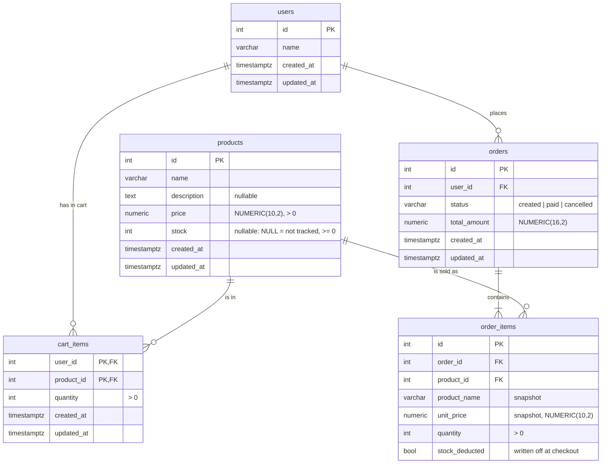

# Details and design decisions

The [README](../README.md) is the short version: how to run the project and the key decisions.
This document has the details: what is implemented, the API, the tests, local development and the
reasoning behind each decision.

**Contents:**
[What is implemented](#what-is-implemented) ·
[Running with Docker](#running-with-docker) ·
[API](#api) ([status codes](#http-status-codes), [errors](#errors)) ·
[Tests](#running-the-tests) ·
[Local development](#local-development) ·
[Project structure](#project-structure) ·
[Design decisions](#design-decisions) ([architecture](#architecture),
[transactions and concurrency](#transactions-and-concurrency), [database schema](#database-schema),
[money](#money), [stock](#stock), [order statuses](#order-statuses), [validation](#validation),
[health check](#health-check)) ·
[Trade-offs and next steps](#trade-offs-and-what-i-would-do-next)

## What is implemented

| Requirement | Where / how |
|---|---|
| Users identified by `X-User-Id`, `POST /users`, seed data, 404 for an unknown user | `app/api/deps.py`, `app/scripts/seed.py` |
| Products: create, partial update, list with `limit`/`offset`, get by id | `app/api/routes/products.py` |
| Cart: add with quantity, change quantity, remove, view lines with line totals and total | `app/api/routes/cart.py` |
| Orders: create from the cart, automatic total, price snapshot, cart emptied, 400 for an empty cart, list, get with items | `app/services/order.py` |
| Money as `NUMERIC` / `Decimal` | `NUMERIC(10,2)` prices, `NUMERIC(16,2)` totals, never `float` |
| Validation: price > 0, quantity ≥ 1, required fields | Pydantic schemas + `CHECK` constraints in the database |
| Correct HTTP statuses and clear error messages | RFC 9457 problem details, see [Errors](#errors) |
| Schema created by Alembic migrations, not `create_all()` | `alembic/versions/` (0001 initial schema, 0002 optional stock) |
| **Nice to have:** tests, including "add to cart → place order" | 198 tests on real PostgreSQL, 98 % coverage |
| **Nice to have:** stock: checked when adding to the cart, written off at checkout | plus returned on cancellation; optional per product (`null` = not tracked) |
| **Nice to have:** order status `created` / `paid` / `cancelled` | state machine in `app/models/order.py` |
| **Nice to have:** filtering and sorting of products | search, price range, availability; sort by date, price, name |
| **Nice to have:** layers: routers / services / repositories | see [Architecture](#architecture) |

## Running with Docker

```bash
docker compose up --build
```

Compose starts PostgreSQL, applies the migrations and loads demo data (a one-off `migrate` job),
then starts the API.

| | |
|---|---|
| Swagger UI | http://localhost:8000/docs |
| ReDoc | http://localhost:8000/redoc |
| Health check | http://localhost:8000/health |

Demo data: users **1 (Alice)** and **2 (Bob)**, and 8 products. It is loaded only into an empty
database. Ports and credentials can be changed through a `.env` file (see `.env.example`). The
database is published on `localhost:5433` so that it does not clash with a local PostgreSQL.

A complete scenario with `curl`:

```bash
# Add two products to Alice's cart and look at it
curl -X POST localhost:8000/cart/items -H "X-User-Id: 1" -H "Content-Type: application/json" \
     -d '{"product_id": 1, "quantity": 2}'
curl -X POST localhost:8000/cart/items -H "X-User-Id: 1" -H "Content-Type: application/json" \
     -d '{"product_id": 2, "quantity": 1}'
curl localhost:8000/cart -H "X-User-Id: 1"

# Place the order, then list the orders and pay
curl -X POST localhost:8000/orders -H "X-User-Id: 1"
curl localhost:8000/orders -H "X-User-Id: 1"
curl -X POST localhost:8000/orders/1/pay -H "X-User-Id: 1"

# Search the catalog: in stock, up to 100.00, cheapest first
curl "localhost:8000/products?in_stock=true&max_price=100&sort_by=price&sort_order=asc"
```

## API

Cart and order endpoints need the `X-User-Id` header. A missing or malformed header returns 422,
and an unknown user returns 404.

| Method | Path | Description | Success | Errors |
|---|---|---|---|---|
| `POST` | `/users` | Create a user `{"name"}` | 201 | 422 |
| `GET` | `/users/{id}` | Get a user | 200 | 404, 422 |
| `POST` | `/products` | Create a product `{"name", "description"?, "price", "stock"?}` | 201 | 422 |
| `GET` | `/products` | List products: pagination, filters, sorting (see below) | 200 | 422 |
| `GET` | `/products/{id}` | Get a product | 200 | 404, 422 |
| `PATCH` | `/products/{id}` | Partial update: only the fields that are sent | 200 | 404, 422 |
| `GET` | `/cart` | Cart lines (current price, quantity, line total) and totals | 200 | 404, 422 |
| `POST` | `/cart/items` | Add `{"product_id", "quantity"}`; merges with an existing line | 201 new line / 200 merged | 404, 409, 422 |
| `PATCH` | `/cart/items/{product_id}` | Set the quantity `{"quantity"}` | 200 | 404, 409, 422 |
| `DELETE` | `/cart/items/{product_id}` | Remove a product from the cart | 204 | 404, 422 |
| `DELETE` | `/cart` | Remove everything from the cart | 204 | 404, 422 |
| `POST` | `/orders` | Checkout: create an order from the cart | 201 | 400, 404, 409, 422 |
| `GET` | `/orders` | My orders, newest first (`limit`, `offset`, `status`) | 200 | 404, 422 |
| `GET` | `/orders/{id}` | An order with its items | 200 | 404, 422 |
| `POST` | `/orders/{id}/pay` | `created` → `paid` | 200 | 404, 409, 422 |
| `POST` | `/orders/{id}/cancel` | `created` → `cancelled`, items go back to stock | 200 | 404, 409, 422 |
| `GET` | `/health` | API and database health (`SELECT 1` with a 2.5 s timeout) | 200 / 503 | |

`GET /products` query parameters: `limit` (1–100, default 20), `offset`, `search` (case-insensitive,
in the name and description), `min_price`, `max_price`, `in_stock` (`true`: in stock or not
tracked, `false`: sold out), `sort_by`
(`created_at` | `price` | `name`), `sort_order` (`asc` | `desc`, default: newest first). Lists are
returned as `{"items": [...], "total": 42, "limit": 20, "offset": 0}`.

Example response of `POST /orders`:

```json
{
  "id": 1,
  "status": "created",
  "total_amount": "299.88",
  "created_at": "2026-11-23T16:05:28.712302Z",
  "updated_at": "2026-11-23T16:05:28.712302Z",
  "items": [
    {"product_id": 1, "product_name": "Mechanical keyboard", "unit_price": "129.99", "quantity": 2, "line_total": "259.98"},
    {"product_id": 2, "product_name": "Wireless mouse", "unit_price": "39.90", "quantity": 1, "line_total": "39.90"}
  ]
}
```

### HTTP status codes

| Situation | Status |
|---|---|
| A user, product or order is created | `201 Created` + `Location` header |
| A new cart line is created | `201 Created` without `Location`: a single cart line has no `GET`, the body is the whole updated cart |
| Read, update; adding a product that is already in the cart | `200 OK` |
| A cart line is removed, the cart is cleared | `204 No Content` |
| Checkout of an empty cart | `400 Bad Request` |
| Unknown user (`X-User-Id`), product, order or cart line; **another user's order** | `404 Not Found` |
| Not enough stock, cart limits exceeded (1000 units per line, 100 products per cart), invalid order status change | `409 Conflict` |
| Invalid body, query, path or header (including a missing `X-User-Id`) | `422 Unprocessable Content` |

The assignment lists 200/201/204/400/404/422. I also use **409 Conflict** for requests that are
valid in themselves but conflict with the *current state* of a resource (the stock level, the
order status). Retrying such a request can succeed later, unlike a malformed request (422).
Another user's order is reported as 404, not 403, so the API does not reveal which order ids exist.

### Errors

All errors use one format, [RFC 9457 Problem Details](https://www.rfc-editor.org/rfc/rfc9457)
(`Content-Type: application/problem+json`). The extra `code` field is a stable, machine-readable
identifier, and `context` holds structured data about the error:

```json
{
  "type": "about:blank",
  "title": "Conflict",
  "status": 409,
  "detail": "Insufficient stock (product 4: requested 5, available 3).",
  "instance": "/orders",
  "code": "insufficient_stock",
  "context": {"items": [{"product_id": 4, "requested": 5, "available": 3}]}
}
```

Validation errors (422) list every problem in `errors`, with the location of the problem:
`{"loc": ["body", "price"], "msg": "Input should be greater than 0", "type": "greater_than"}`.
Unexpected errors return a generic 500 without internal details.

## Running the tests

```bash
docker compose run --rm tests        # or: make test
```

The tests run against **real PostgreSQL**. No SQLite or mocks: the code relies on PostgreSQL
behaviour (`SELECT ... FOR UPDATE`, `ON CONFLICT`, `NUMERIC`, `CHECK` constraints). The test run
creates a separate database `<POSTGRES_DB>_test` and builds its schema **with the Alembic
migrations**, so the migrations are tested too. Each test starts with empty tables.

What is covered (198 tests, 98 % coverage of lines and branches):

* the full scenario "add to cart → place order" (`tests/integration/test_checkout_scenario.py`);
* every endpoint, including validation and the error responses;
* business rules: price snapshot, stock checks, atomic checkout (on failure nothing changes),
  status transitions, stock returned on cancellation;
* **race conditions**, with real concurrent transactions: two buyers and the last unit, a
  double-submitted checkout, concurrent "add to cart" requests, concurrent pay/cancel, and the
  product lock mode (it holds back a stock change but not adding the product to another cart). To
  make sure these tests are meaningful, I removed the row locks on purpose: the tests then fail;
* migrations: upgrade → downgrade → upgrade, and "models and migrations are in sync"
  (the same check as `alembic check`).

## Local development

Requires [uv](https://docs.astral.sh/uv/) (it installs the right Python version itself).

```bash
uv sync                                  # dependencies, including dev tools
cp .env.example .env                     # the app will use the db container on localhost:5433
docker compose up -d db                  # only PostgreSQL
uv run alembic upgrade head              # schema
uv run python -m app.scripts.seed        # demo data (optional)
uv run uvicorn app.main:app --reload     # http://localhost:8000/docs
```

Quality checks (CI runs the same ones, see `.github/workflows/ci.yml`):

```bash
uv run pytest --cov          # tests
uv run ruff check .          # lint
uv run ruff format --check . # formatting
uv run mypy                  # strict type checking
uv run alembic check         # models and migrations are in sync
```

A new migration after a model change: `uv run alembic revision --autogenerate -m "describe change"`.
Review the generated file before committing it. `make help` lists shortcuts for all of these.

## Project structure

```
app/
├── main.py              # application factory: routers, exception handlers, OpenAPI
├── api/                 # HTTP layer
│   ├── routes/          # endpoints: users, products, cart, orders, health
│   ├── deps.py          # dependencies: DB session, services, current user, path params
│   └── errors.py        # exceptions -> RFC 9457 responses; error docs in OpenAPI
├── services/            # business logic and transaction boundaries
├── repositories/        # database queries (SQLAlchemy); no business rules, never commit
├── models/              # SQLAlchemy ORM models (tables, constraints, order state machine)
├── schemas/             # Pydantic request/response schemas (separate from the ORM models)
├── core/                # settings, domain errors, constants, money helpers, logging
├── db/                  # declarative base with naming convention, engine, session
└── scripts/seed.py      # demo data
alembic/                 # migrations (the only way the schema is created)
tests/
├── unit/                # schemas, order state machine, error handling, OpenAPI contract
└── integration/         # the API end to end against PostgreSQL, concurrency, migrations
```

## Design decisions

### Architecture

```
HTTP request → router (api/routes) → service (services) → repository (repositories) → PostgreSQL
```

* **Routers** handle HTTP only: parse and validate input (Pydantic), call a service, map the result
  to a response schema, set the status code and `Location`.
* **Services** hold the business rules (stock, status transitions, price snapshot) and **own the
  transaction**: each use case ends with an explicit `commit()`. Services raise domain errors
  (`app/core/exceptions.py`) that know nothing about HTTP. The mapping of error category to status
  code (`NotFound` → 404, `Conflict` → 409, `BusinessRuleViolation` → 400) is in one place,
  `app/api/errors.py`.
* **Repositories** contain the queries only and never commit, so a service can combine several
  repository calls in one transaction.
* **Schemas** (Pydantic) are separate from the **models** (SQLAlchemy). The API contract does not
  depend on the table layout, and no column is exposed by accident.

Dependencies are wired with FastAPI `Depends`. One request gets one `AsyncSession`, which all
services of that request share, so they share one transaction too.

### Async SQLAlchemy 2.0

FastAPI is async-first, so the database layer is async too (`asyncpg`). This means no thread pool
for queries and many concurrent requests per worker. Async ORM code has a few pitfalls, handled
explicitly:

* `expire_on_commit=False`: objects stay readable after a commit (an async session cannot reload
  expired attributes implicitly).
* Relationships are declared with `lazy="raise"`: every relationship a response needs is loaded
  explicitly (`selectinload` / `joinedload`). A forgotten eager load fails immediately instead of
  doing hidden I/O.
* `eager_defaults=True` on timestamped models: the database-generated `created_at` / `updated_at`
  values come back in the same `INSERT/UPDATE ... RETURNING` statement.

### Why services commit (and the session dependency does not)

With FastAPI's default dependency scope, the code after `yield` in a dependency runs **after the
response has been sent**. A commit placed there could fail after the client has already received
`201 Created`. So the dependency only opens and closes the session: closing rolls back anything
that was not committed, for example after a domain error. The commit is the last step of each
service method, before the response is built.

### Transactions and concurrency

Checkout runs in **one transaction**: either the order is created, the stock is written off and the
cart is emptied, or nothing changes.

1. `SELECT ... FOR UPDATE` on the user's cart lines. A second, concurrent checkout of the same cart
   (a double click) waits, then finds the cart empty and gets 400. No duplicate order is possible.
2. `SELECT ... FOR NO KEY UPDATE` on the products, **always in ascending id order**. Two buyers
   cannot both take the last unit (one gets 201, the other 409). The fixed lock order rules out
   deadlocks between checkouts and cancellations that touch the same products. `NO KEY` is enough
   because only `stock` changes: the lock still serializes every stock change, but does not block
   foreign-key checks (`FOR KEY SHARE`), so other customers can add the product to their carts
   while a checkout is running.
3. Stock is validated again for every line, under the lock. The cart does not reserve stock, so the
   stock may have changed since the item was added. All shortages are reported at once.
4. Stock is decremented, and the order is created with a **snapshot of each product's name and
   price**. The total is computed with `Decimal`.
5. Only the cart lines that were ordered are deleted. A product added to the cart *during* the
   checkout is not lost.

Other places that need care:

* **Add to cart** is one atomic statement, `INSERT ... ON CONFLICT (user_id, product_id) DO UPDATE
  SET quantity = quantity + excluded.quantity`. Concurrent adds of the same product merge into one
  line instead of failing on the primary key (no read-then-insert race). The resulting quantity is
  then checked against the stock; if the check fails, the statement is rolled back.
* **Pay / cancel** lock the order row, so concurrent transitions are serialized and the second one
  gets 409. Cancelling returns the units to stock, with the same product lock order as checkout.
* **Database constraints** are the last line of defence behind the application checks:
  `CHECK (stock >= 0)`, `CHECK (quantity > 0)`, `CHECK (price > 0)`, the allowed status values,
  unique keys and foreign keys.

Every one of these scenarios has a test that runs real concurrent transactions.

### Database schema



* **No `carts` table.** A user has exactly one cart, which is the set of their `cart_items`. The
  composite primary key `(user_id, product_id)` guarantees that a product appears in a cart once,
  so the API addresses a cart line by product id (`/cart/items/{product_id}`).
* **Order lines are snapshots** (`product_name`, `unit_price`): changing or renaming a product never
  changes an existing order. The cart, on the other hand, always shows *current* prices.
* **Foreign keys say what may be deleted:** `cart_items` cascade with the user or product;
  `orders → users` and `order_items → products` are `RESTRICT`, because order history must survive.
  Hard-deleting products would require soft delete, so product deletion is intentionally out of scope.
* **Order status** is `VARCHAR(20)` + `CHECK`, not a native PostgreSQL `ENUM`. Adding a status later
  is a simple constraint change, while `ALTER TYPE ... ADD VALUE` has restrictions.
* **Indexes** support the access paths: `orders (user_id, created_at)` for "my orders, newest
  first"; `products (created_at)`, `(price)`, `(name)` for sorting and filtering; indexes on
  foreign keys that are not the leading column of a primary or unique key.
* `IDENTITY` primary keys (the modern SQL-standard alternative to `SERIAL`), `TIMESTAMPTZ`
  timestamps set by the database clock, and a **naming convention** for constraints, so that
  Alembic always generates the same, predictable names.

### Money

Money is `NUMERIC` in the database and `Decimal` in Python, never `float`. In the cart test,
0.10 + 0.20 is exactly `"0.30"`. The API accepts a price as a JSON number or a string, rejects
more than 2 decimal places and values that do not fit the column, and **returns money as a string**
with two decimals (`"19.90"`). JavaScript clients parse JSON numbers as binary floats, so a string
keeps the exact value.

### Stock

* When a product is added to the cart, or a quantity changes, the resulting quantity is checked
  against the stock: 409 with `requested` / `available` in the response.
* The cart **does not reserve** stock. Holding stock for abandoned carts would need expiry logic.
  Stock is therefore validated again, under row locks, at checkout, and written off there.
* Cancelling an order returns its units to stock.
* Stock tracking is **optional**. A product created without `stock` (only `name`, `description`
  and `price`, as in the assignment) has `"stock": null`: its stock is not tracked, so it is never
  checked, written off or returned, and `in_stock=true` includes it. `PATCH {"stock": 10}` turns
  tracking on, `PATCH {"stock": null}` turns it off. `null` is stored as SQL `NULL`;
  `CHECK (stock >= 0)` still applies to tracked stock.
* Each order line records whether checkout wrote it off the stock (`order_items.stock_deducted`).
  Cancellation returns units only when they were written off **and** the product still tracks
  stock, so it never returns units that were not taken. The units are added to the current stock:
  if tracking was switched off and on again with a new value in between, they are added to that
  value.
* A cart line is limited to 1000 units and a cart to 100 different products
  (`cart_items_limit_exceeded`). Together the limits keep every amount, the order total included,
  within the precision of the money columns: the largest possible order is
  100 × 1000 × 99 999 999.99 < 10¹³, while the total column is `NUMERIC(16, 2)`. The 100-product
  limit is checked when a new line is added, but concurrent adds of different products can still
  leave 101 lines in a cart. Checkout enforces it strictly, under the row locks, with a 409.

### Order statuses

`created → paid` and `created → cancelled`. `paid` and `cancelled` are final: cancelling a paid order
would require a refund flow. The rules live in one place (`ORDER_STATUS_TRANSITIONS` and
`Order.transition_to()` in `app/models/order.py`) and are unit-tested. The transitions are separate
action endpoints (`POST /orders/{id}/pay`, `/cancel`, like Stripe's API), not `PATCH {"status": ...}`.
Changing a status is a business operation with side effects (returning stock), not a free edit of a
field.

### Validation

* Request bodies reject **unknown fields** and list endpoints reject **unknown query parameters**
  (`extra="forbid"`), so a typo such as `"prise"` or `?sortby=price` gives 422 instead of being
  silently ignored.
* Numeric body fields are **strict**: `true`, `"5"` and `1.5` are not accepted as an integer
  quantity.
* `PATCH` distinguishes "field not sent" (keep the value) from `null`. `null` is rejected for
  `name` and `price` (and the OpenAPI schema does not offer it for them); for `description` it
  clears the text, for `stock` it turns tracking off.
* Ids in paths, bodies and the header are limited to the PostgreSQL `INTEGER` range, so a huge id
  gives 422 instead of a database error (500).
* `LIKE` wildcards in `search` are escaped: searching for `100%` finds the text "100%".
* Offset pagination always sorts by a unique tie-breaker (`id`), so pages never repeat or skip rows.

### Health check

`GET /health` runs `SELECT 1` with a 2.5 s timeout and answers:

* `200 {"status": "ok", "database": "ok"}` when the database responds;
* `503 {"status": "unavailable", "database": "unavailable"}` when the database refuses the
  connection, fails or does not answer in time. The cause is logged.

A health check that hangs or answers 500 would hide the real state from the orchestrator. The
compose healthcheck of the `api` container calls this endpoint, so a lost database marks the
container unhealthy.

## Trade-offs and what I would do next

* **Authentication.** `X-User-Id` stands in for it, as the assignment requires. In production this
  would be a JWT/OAuth2 identity, and catalog writes would be admin-only.
* **Idempotency keys** (`Idempotency-Key` header) for `POST /orders`, to make client retries safe
  across network failures, not only for concurrent double submits.
* **Stock reservation** with a TTL, if the business wants "items in the cart are held for you".
* **Search:** `ILIKE '%term%'` cannot use a B-tree index. For a large catalog I would add a
  `pg_trgm` GIN index or full-text search.
* **Keyset (cursor) pagination** for large lists. Offset pagination gets slower on deep pages.
* **Payments and events:** replace `POST /orders/{id}/pay` with a payment provider webhook, and
  publish order events (transactional outbox) for emails, analytics and so on.
* **Observability:** structured JSON logs with request ids, metrics, tracing (FastAPI supports
  OpenTelemetry natively).
* **Migrations as a release step:** the compose `migrate` job already separates them from the API
  start; in Kubernetes this would be a Job before the rollout.